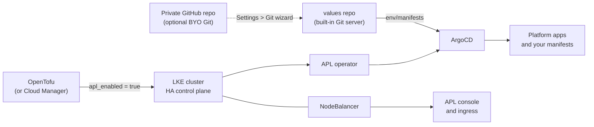

# Akamai App Platform for LKE Lab

[](https://github.com/idvoretskyi/akamai-lke-app-platform/actions/workflows/ci.yml)
[](LICENSE)
[](https://opentofu.org)
[](https://kubernetes.io)
[](https://search.opentofu.org/provider/linode/linode/latest)
[](https://techdocs.akamai.com/app-platform/docs)
[](examples/gitops-hello/)

An OpenTofu lab that provisions an Akamai Linode Kubernetes Engine (LKE)
cluster with **App Platform for LKE** (APL) enabled, plus a scripted
post-install flow and a worked GitOps example.

App Platform is installed by LKE itself through the native `apl_enabled`
flag (the "automatic installation" path), so this repo contains no Helm
releases. It is a sibling of
[akamai-lke-gpu-cluster](https://github.com/idvoretskyi/akamai-lke-gpu-cluster)
and follows the same layout, CI gates and destroy/apply cost model.

## What you get

- An LKE cluster (Kubernetes 1.36) with the HA control plane, a Control
  Plane ACL and a Cloud Firewall.
- One fixed pool of 3 x `g6-dedicated-8` (8 vCPU / 16 GB) nodes.
- App Platform: Keycloak, ArgoCD, Istio, Harbor, monitoring and the rest,
  managed by the APL operator from a Git `values` repo.
- Scripts to wait for the install, read the admin credentials and clone the
  values repo.
- [`examples/gitops-hello`](examples/gitops-hello/): plain manifests that
  ArgoCD reconciles from the values repo.
- Preparation for **BYO Git**: moving the values repo to a private GitHub
  repo.

## Architecture



## Quick start

Prerequisites: `tofu` (>= 1.9), `kubectl`, `linode-cli` configured (or
`LINODE_TOKEN` exported), and `gh` for the BYO Git step.

```bash
cd tofu
cp tofu.tfvars.example tofu.tfvars   # set allowed_kubectl_ips at least
tofu init
tofu apply -var-file=tofu.tfvars     # creates the cluster

scripts/apl-wait.sh                  # another 10-15 min; prints the portal URL
scripts/apl-credentials.sh           # initial admin username and password
```

Then open the portal URL and log in:

1. Set a new password (the first login forces it).
2. Complete the **Object Storage wizard** that opens automatically. It needs
   a Linode personal access token with Object Storage read/write; the token
   is used once to create buckets and is not stored. You can reopen the
   wizard later from Platform view > Maintenance.

## GitOps example

App Platform reconciles everything under `env/manifests/` in its values
repo. Each `namespaces/<ns>/` directory becomes one ArgoCD Application;
`global/` holds cluster-scoped resources; `apl-*` directories belong to the
operator.

```bash
make -C examples/gitops-hello clone sync push status
```

See [`examples/gitops-hello/README.md`](examples/gitops-hello/README.md).

## BYO Git (recommended before you rely on it)

By default the values repo lives on a Git server **inside the cluster**, so
`tofu destroy` deletes it with all history. The documented production path
moves it to an external, private repo:

```bash
tofu/scripts/create-values-repo.sh   # gh repo create <owner>/<values_repo_name> --private
```

The script refuses to reuse a non-empty repo and never handles tokens. Then,
by hand:

1. Create a **fine-grained PAT** scoped to that single repo with
   *Contents: Read and write*.
2. In the portal: **Platform view > Settings > Git**. Enter the repo's HTTPS
   URL, your username and the PAT. The wizard pushes the existing history to
   the new repo and repoints the platform.
3. Clone the external repo from now on:
   `VALUES_REPO_URL=https://github.com/<owner>/<repo>.git tofu/scripts/apl-values-clone.sh`

This switch is the one unavoidable manual step: App Platform exposes no API
or IaC for it on an existing installation.

## Configuration

All variables are in [`tofu/variables.tf`](tofu/variables.tf), with an
annotated [`tofu.tfvars.example`](tofu/tofu.tfvars.example). Constraints
enforced as validations:

| Rule | Why |
|---|---|
| `ha_control_plane = true` when `apl_enabled` | App Platform requires it |
| `node_count >= 3` when `apl_enabled` | App Platform minimum |
| `node_type` is Dedicated CPU or Premium | Shared CPU is unsupported |
| `kubernetes_version >= 1.33` | App Platform minimum |

`apl_enabled` is **write-once**: changing it on an existing cluster destroys
and recreates the cluster.

## Cost

List prices checked 2026-10-09 (`linode-cli linodes types`, `lke types`,
`nodebalancers types`):

| Resource | Monthly |
|---|---|
| 3 x `g6-dedicated-8` (8 vCPU / 16 GB) | $432 |
| HA control plane | $60 |
| NodeBalancer (console and ingress) | $10 |
| Block Storage (at least 11 volumes, $0.10/GB) | depends on PVC sizes |

About **$502/month plus volumes** if left running. With `g6-dedicated-4`
(4 vCPU / 8 GB, the documented minimum) it is about $286/month plus volumes.
Billing for compute stops when the cluster is destroyed:

```bash
cd tofu && tofu destroy                        # stop paying
cd tofu && tofu apply -var-file=tofu.tfvars    # bring it back (fresh install)
```

Recreating gives you a **fresh** App Platform with a new admin password and,
without BYO Git, an empty values repo. Check Cloud Manager > Volumes after a
destroy for volumes that outlived the cluster.

## Security

- `allowed_kubectl_ips` drives both the Control Plane ACL and the firewall's
  443 rule. The default `0.0.0.0/0` triggers a warning; narrow it.
- The ACL does **not** protect the App Platform console, which is public
  behind its NodeBalancer and guarded by Keycloak. Consider MFA for the admin
  account.
- The firewall must keep admitting `192.168.255.0/24` (the NodeBalancer
  backend range) or the portal stops working; a `check` warns about this.
- Credentials are only printed, never written to disk. `.values/` (which may
  hold a URL with embedded credentials for the built-in Git server) is
  git-ignored.

## Troubleshooting

| Symptom | Likely cause and fix |
|---|---|
| `apl-wait.sh` times out, pods `Pending` with unbound PVCs | Account Volume limit. Delete unattached volumes or ask Linode support to raise the limit. |
| No portal URL after 30 minutes, wildcard cert not ready | Let's Encrypt issue. Check `kubectl get secret -n istio-system`; the documented fix is to recreate the cluster. |
| `kubectl` times out but the portal works | Your IP is not in `allowed_kubectl_ips`. |
| Portal unreachable, `kubectl` works | Firewall no longer admits the NodeBalancer range; see `node_cidrs`. |
| No `apl-*` namespaces at all | Cluster created with `apl_enabled = false`; it cannot be enabled in place. |

See the [App Platform known issues](https://techdocs.akamai.com/app-platform/docs/known-issues).

## Not covered

Custom domains and external DNS, BYO wildcard certificates, OIDC, App
Platform teams and app catalog configuration, the Helm-based manual install,
Object Storage bucket IaC (the portal wizard handles it), and anything
GPU-related (see the sibling repo).

## Repository layout

```text
tofu/                     OpenTofu root module
  cluster.tf              LKE cluster, apl_enabled, HA, ACL
  firewall.tf             Cloud Firewall (keeps NodeBalancer range open)
  checks.tf               advisory checks
  scripts/                kubeconfig merge, apl-wait, credentials, values clone, BYO Git repo
examples/gitops-hello/    manifests + Makefile for the values repo loop
AGENTS.md                 constraints and conventions for agents and humans
```

## License

[MIT](LICENSE)
